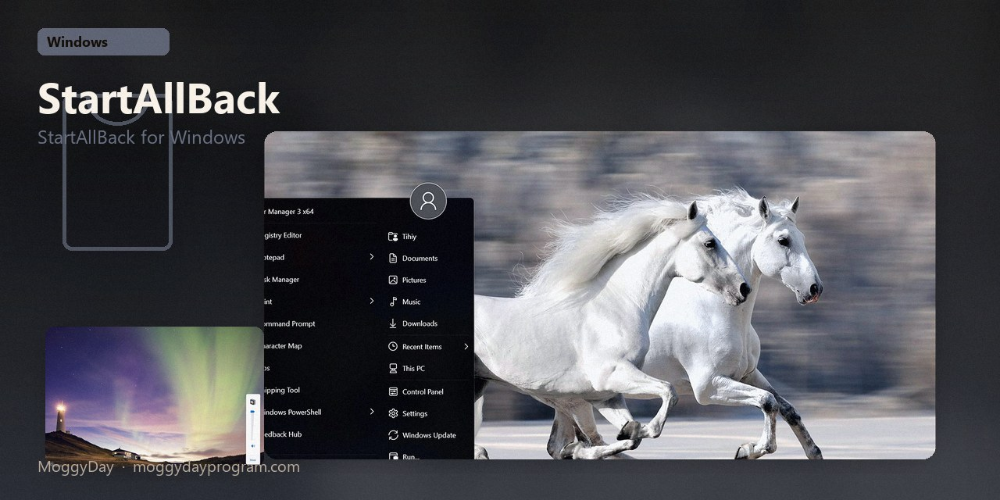
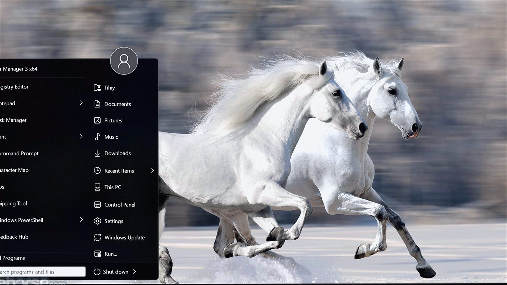
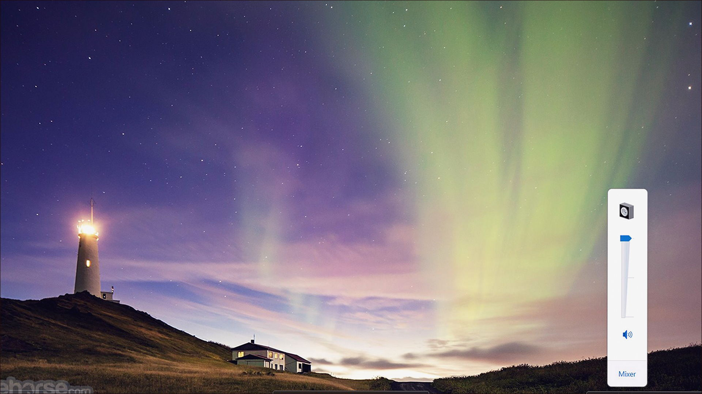
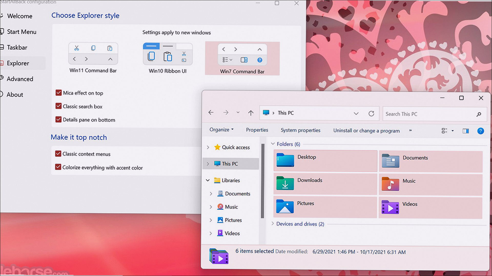

# StartAllBack 3.9

StartAllBack for Windows. StartAllBack on Windows 10/11 x64. 2 MB. Requirements, screenshots, MoggyDay Launcher.

[Pages](https://thresholdtivibrate.github.io/startallback-windows/) · [RU](https://moggydayprogram.com/programs/startallback) · [EN](https://moggydayprogram.com/en/programs/startallback)

  

  
  
  

1. Open the RU or EN card on moggydayprogram.com
2. Use the main button, or the launcher for large archives

Category: [Utilities catalog](https://moggydayprogram.com/categories/utilities)

- [Start11](https://moggydayprogram.com/programs/start11)
- [StartIsBack](https://moggydayprogram.com/programs/startisback)

No installer in this git repo.
